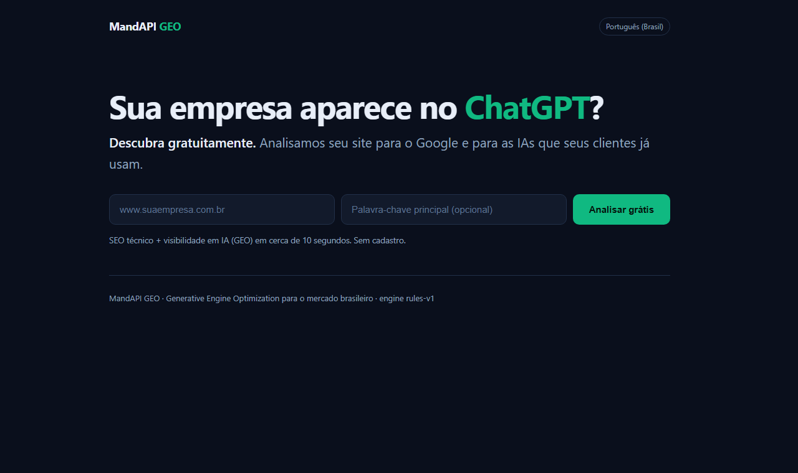
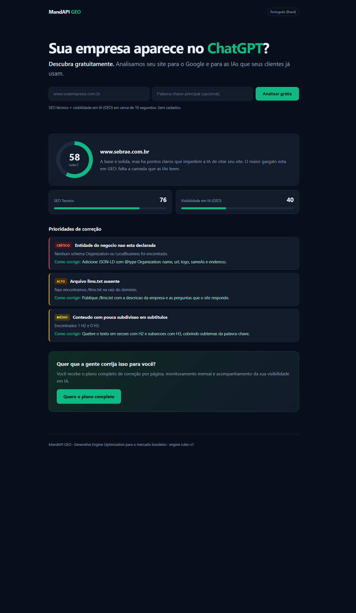

# MandAPI GEO

**AI Search Visibility + SEO Content Intelligence — mercado brasileiro / LatAm.**

输入一个网址，输出一份报告：这个站在 Google 排得怎么样、**以及 ChatGPT / Gemini / Perplexity 能不能找到并引用它**。

> 定位一句话（葡语落地页主标题）：
> **"Sua empresa aparece no ChatGPT? Descubra gratuitamente."**

---

## 0. Como aparece para o cliente

**落地页（pt-BR）**



**扫描结果（分数 + 优先级问题清单）**



---

## 1. 现在能跑什么

| 能力 | 状态 | 说明 |
| --- | --- | --- |
| 抓取网页 | ✅ | httpx，跟随重定向，记录耗时/字节/状态码 |
| 解析 HTML | ✅ | title / meta / H 标签 / JSON-LD / 图片 / 链接 / 文本 |
| SEO 分析 | ✅ | 18 项检查（title、meta、H1、canonical、viewport、HTTPS、schema、robots、sitemap、TTFB…） |
| GEO 分析 | ✅ | 15 项检查（llms.txt、**AI bot 屏蔽**、实体 schema、FAQ、answer-first、可抽取性、引用信号…） |
| 评分 | ✅ | 分领域加权 → 0-100 + A-F 等级 + 葡语诊断摘要 |
| 报告 | ✅ | Markdown（确定性，无需 LLM）+ 可选 AI 自然语言增强 |
| CLI | ✅ | `mandapi-geo <url>` |
| HTTP API | ✅ | FastAPI，`POST /api/scan` |
| 葡语落地页 | ✅ | `web/index.html`，输入网址→出分数与问题清单 |
| 测试 | ✅ | 20 个，含历史 bug 的回归测试 |

### 还没做（故意不做）

- 多页爬取 / 全站扫描（现在只分析单页）
- SERP Top10 内容差距分析（需要付费 SERP API，属"后续扩展"）
- 用户系统、计费、任务队列、数据库（"验证付费意愿后再做"）
- 限流（配置项 `FREE_SCAN_DAILY_LIMIT` 已留，逻辑未接）

---

## 2. 快速开始

```powershell
# 依赖
uv venv
uv pip install -e ".[dev]"

# CLI：分析一个站
.venv\Scripts\python.exe -m mandapi_geo.cli https://www.exemplo.com.br
# 带 AI 摘要（需 LLM_API_KEY）：
.venv\Scripts\python.exe -m mandapi_geo.cli https://www.exemplo.com.br --llm
# 同时导出 JSON：
.venv\Scripts\python.exe -m mandapi_geo.cli https://www.exemplo.com.br --json reports/exemplo.json

# 网页（落地页 + API）
.venv\Scripts\uvicorn.exe mandapi_geo.api:app --reload --port 8000
# 打开 http://localhost:8000

# 测试
.venv\Scripts\python.exe -m pytest tests/ -q
```

配置：复制 `.env.example` 为 `.env`。**不配任何 key 也能完整跑通**——LLM 只是可选增强。

---

## 3. 评分校准（真实数据）

拿真实站点跑过，确认分数有区分度、不是"什么站都低分"：

| 站点 | SEO | GEO | 总分 | 等级 |
| --- | ---: | ---: | ---: | --- |
| hostinger.com.br（技术 SEO 强） | 94 | 78 | **86** | **A** |
| sebrae.com.br | 76 | 40 | 58 | C |
| example.com（裸页） | 50 | 40 | 45 | D |

两个可复用的商业洞察：

1. **优化好的站能拿 A** —— 报告有可信度，不是恐吓式营销。
2. **GEO 普遍显著落后 SEO**（Sebrae 40 vs 76）—— 这正是销售话术：
   > "No Google você está bem. Na IA, você é invisível."

---

## 4. 架构与"换模块"契约

```text
URL
 └─> fetcher.py        抓取（httpx）
      └─> parser.py     HTML → PageFacts
           ├─> analyzers/seo.py    → (checks, issues)
           └─> analyzers/geo.py    → (checks, issues)
                └─> scoring.py     → 加权评分
                     └─> report.py → Markdown / LLM 摘要
```

**设计目标：任何一层都能被开源项目整层替换，不用动其他层。**

| 想替换 | 只改这一个文件 | 保持的签名 |
| --- | --- | --- |
| 抓取 → Crawl4AI / Firecrawl | `fetcher.py` | `fetch_page(url) -> FetchResult` |
| SEO → crawlseo | `analyzers/seo.py` | `analyze(page, site) -> (list[Check], list[Issue])` |
| GEO → geo-optimizer-skill | `analyzers/geo.py` | 同上 |
| 报告 → Dify | `report.py` | `generate_ai_summary(report) -> str | None` |

现在**刻意不 fork 这些仓库**：栈各不相同（TS/Go/Python），全部拉起等于 4 套部署 + 4 套认证，违反"禁止过度工程化"。
先用自家规则引擎跑通闭环，验证有人付钱后，再按层替换。

复用池验真结论见 **[`docs/REUSE_POOL.md`](docs/REUSE_POOL.md)**（含一条 license 警告）。

---

## 5. 任务书进度

| Task | 内容 | 状态 |
| --- | --- | --- |
| 1 | 开源项目验证 | ✅ 六个仓库逐个 API 验真，产出 `docs/REUSE_POOL.md` |
| 2 | 第一个 Demo | ✅ CLI 可对任意网址出报告 |
| 3 | 营销页面 | ✅ `web/index.html`（pt-BR，输入网址即出分数） |
| 4 | 找 20 家巴西企业 | ⬜ 待做（需人工触达） |

---

## 6. 已知问题（技术债，按优先级）

1. **robots.txt 缺失会被报两次**（SEO 一次、GEO 一次），文案不同但根因相同 → 付费报告里显得凑数。建议去重。
2. **被反爬站点报错不友好**：Rock Content 返回 429，用户看到的是 `HTTP 429` 而不是"该站点拦截了我们的机器人"。
3. **单页分析**：只看入口页，不爬内链 → 无法给全站结论。
4. **TTFB 是本机测量**：不是用户所在地的真实速度，文案已注明测量来源，但数值参考性有限。
5. **无持久化**：每次扫描 stateless，无法做"环比上次"的复购钩子。