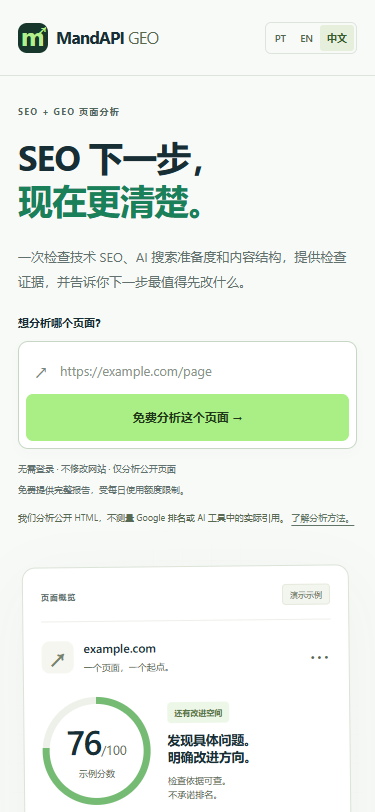

# MandAPI GEO



本轮本地验收：145 项 Python、26 项 JavaScript 测试通过，三语手机首屏及修复复测流程通过浏览器验收。详见 [Conversion V2 记录](docs/CONVERSION_V2.md) 与 [基础验收记录](docs/VALIDATION.md)。

单页技术 SEO 与 AI 搜索准备度审计工具。输入一个公开网页地址，读取服务器返回的 HTML，输出可核对的证据、问题优先级和修正建议。网站提供葡萄牙语、英语、简体中文界面，规则引擎为 `rules-v2`。

评分是针对已执行检查的启发式结果。它不能证明 Google 排名、实际流量或 ChatGPT / Gemini / Perplexity 的引用情况；当前不执行 JavaScript，也不扫描整个网站。`llms.txt`、训练爬虫和扩展用途的 robots 规则作为观察项展示，不据此断言品牌在 AI 中“不可见”。

FAQ、数字密度、列表 / 表格和 JSON-LD 等格式的适用性取决于页面内容，不要求每个页面都有；缺少这些可选形式不会被统一判为高危缺陷。请求超时或文件格式无效表示证据不足，不自动等同于明确缺失或封禁。

## 当前功能

- HTML 元数据、canonical、标题结构、链接、图片、JSON-LD、页面内容和索引指令检查。
- 按目标页面路径评估搜索爬虫的 robots 规则，支持重复分组、连续 User-agent、Allow 优先级及通配符；区分缺失、无法确认和明确封禁。
- 获取并校验 robots.txt、sitemap、llms.txt。公开地址限制、DNS 校验、固定 IP 连接、逐跳重定向校验和请求资源上限同时生效。
- SEO / GEO 分项报告、证据与建议；网页可导出 JSON 和 Markdown。CLI 默认输出葡萄牙语报告。
- 报告先展示最多三项实际问题；可主动保存或导入一份本地基线，修复后复测同页，查看已解决、新增、仍存在及待确认的检查，导出比较 Markdown 或打印 PDF。
- 比较核对页面、重定向、时间、引擎及规则版本；检查覆盖和权重一致才显示分数差值。旧报告可导入查看，版本不足时不声称修复或分数变化。
- 三语言首页、方法说明、隐私说明、GEO 入门页；服务端输出 canonical、hreflang、结构化数据、robots.txt 和 sitemap.xml。
- 默认每客户端每天 3 次扫描、最多 2 个并发扫描。使用单进程内存计数，UTC 00:00 重置，重启清空；失败扫描也占用已接纳的额度。

还没有用户系统、付款、任务队列、历史报告数据库、全站爬取或真实 AI 引用监测。项目尚未绑定正式域名或服务器，也没有在此仓库配置远程发布目标。

## 本地运行

需要 Python 3.10+；容器使用 Python 3.12。以下命令在仓库根目录运行，示例为 PowerShell：

```powershell
uv venv
uv pip install -e ".[dev]"
Copy-Item .env.example .env
.venv\Scripts\python.exe -m uvicorn mandapi_geo.api:app --host 127.0.0.1 --port 8000 --reload --no-proxy-headers
```

打开 [葡萄牙语首页](http://127.0.0.1:8000/)、[英语首页](http://127.0.0.1:8000/en) 或 [中文首页](http://127.0.0.1:8000/zh)。Linux / macOS 使用 `.venv/bin/python`。无需 API Key 即可运行全部规则检查。

| 页面 | 葡萄牙语 | 英语 | 中文 |
| --- | --- | --- | --- |
| 首页 | `/` | `/en` | `/zh` |
| 方法说明 | `/metodologia` | `/en/metodologia` | `/zh/metodologia` |
| 隐私说明 | `/privacidade` | `/en/privacidade` | `/zh/privacidade` |
| GEO 入门 | `/guia-geo` | `/en/guia-geo` | `/zh/guia-geo` |

HTML 文件随仓库提供；编辑页面生成源后运行 `.venv\Scripts\python.exe web/build_pages.py`，再检查三个语言版本。正式部署步骤见 [部署说明](docs/DEPLOYMENT.md)。

## API 与 CLI

`POST /api/scan` 请求示例：

```json
{
  "url": "https://example.com/",
  "keyword": null,
  "ai_summary": false,
  "language": "zh-CN"
}
```

`language` 支持 `pt-BR`、`en`、`zh-CN`，默认 `pt-BR`。`keyword` 是可选的报告上下文，目前不触发关键词排名或搜索结果分析。响应包含 `score`、`areas`、`issues`、`facts`、`site` 等字段，另含 `schema_version=1` 与 `scoring_version=readiness-2026-09-26` 供复测判断兼容性。输入无效返回 400，校验失败或页面无法扫描返回 422，额度用完返回 429，扫描容量已满返回 503。请求体上限为 8 KiB；上传请求体超时返回 408。`GET /health` 提供健康状态。

```powershell
.venv\Scripts\python.exe -m mandapi_geo.cli https://example.com/
.venv\Scripts\python.exe -m mandapi_geo.cli https://example.com/ --json reports/example.json
```

CLI 的 `--llm` 为可选葡萄牙语摘要，需要自行配置 `LLM_API_KEY` 与服务地址，可能产生服务商费用。公开 API 的 `ai_summary` 默认关闭；只有 `PUBLIC_AI_SUMMARY=true` 且请求语言为 `pt-BR` 时允许开启。LLM 摘要不增加搜索排名或引用测量能力。

## 验证与部署

```powershell
.venv\Scripts\python.exe -m pytest tests -q
node --test tests/js/comparison.test.cjs
# 可选：先启动本地 8000 服务，安装开发用 Playwright 并准备 Edge
.venv\Scripts\python.exe tests/browser/conversion_v2_smoke.py
```

测试覆盖规则、评分、网络护栏及 API 等回归场景，以仓库中的测试为准。需要额外检查交互时，可选使用 Playwright 检查桌面 / 移动视口、三语言切换、扫描错误、报告导出和键盘导航；它不是生产运行依赖，也不能替代真实浏览器验收。

`requirements.lock` 固定生产依赖并记录哈希。Docker 使用 `pip install --require-hashes -r requirements.lock` 安装依赖，从源代码工作目录启动单个 Uvicorn worker，并复制 `web/` 页面和资源。`compose.yaml` 默认只发布到宿主机 `127.0.0.1:8000`，不自动申请域名、TLS、服务器或付费服务。

默认 `SITE_INDEXABLE=false`：页面带 noindex、robots 禁止抓取、sitemap 无页面条目。确认 HTTPS 域名、运营信息和生产配置后，设置 `SITE_URL=https://你的实际域名` 及 `SITE_INDEXABLE=true`。`SITE_URL` 必须是无子路径的公开 HTTP(S) origin；不要填写 `/geo` 等前缀。

## 数据与后续迭代

服务端目前不持久保存扫描报告，不建立用户账户。限流在内存保存短期加盐 IP 哈希；客户端 IP 仍会在请求处理阶段被使用。应用运行日志、反向代理和托管平台可能保留 IP、访问路径和时间；开启 LLM 摘要会把报告中的域名、评分和部分问题描述发送给配置的服务商。正式上线前，需要补充真实运营主体、托管商、日志保留规则及联系邮箱，更新三语言隐私页面。

只有主动点击保存或导入才将精简的基线写入浏览器 localStorage（最多一份、1 MiB，不保存原始 HTML 或页面全文）。刷新或切语言会恢复基线，但不自动发起扫描；可随时清除。导入文件不上传到服务器，来源与完整性未经认证，不可当作独立取证。浏览器禁止存储时，只在当前页面会话保留。

下一阶段按以下顺序推进：

1. 按 [服务商首单验证方案](docs/COMMERCIAL_VALIDATION.md) 验证真实交付需求、重复使用和付费意愿。目前没有客户、收入或盈利证据。
2. 确定域名与托管环境，部署 HTTPS 预览并验收，再开启索引、配置 Search Console 和基础监控。
3. 按实际使用反馈选择后续能力：受限全站扫描、项目历史、协作交付或任务队列；账户与计费以验证结果为依据。
4. 如建设真实 AI 引用测量，必须记录查询、平台、日期、地区、实际答案与引用证据；与技术准备度评分分别呈现。

抓取、解析、分析、评分、报告依次位于 `network.py` / `fetcher.py`、`parser.py`、`analyzers/`、`scoring.py`、`report.py`。历史开源方案调查保留在 [REUSE_POOL.md](docs/REUSE_POOL.md)，其中的候选方案不代表当前已集成。
